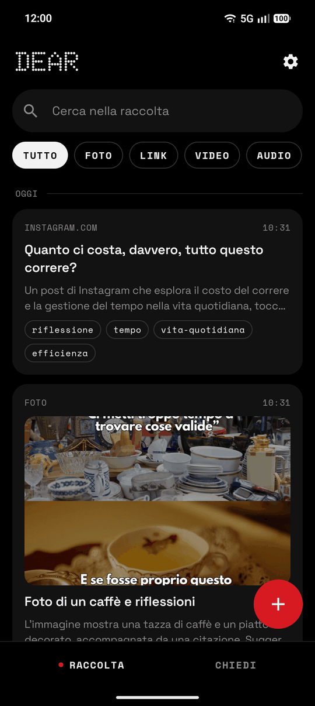
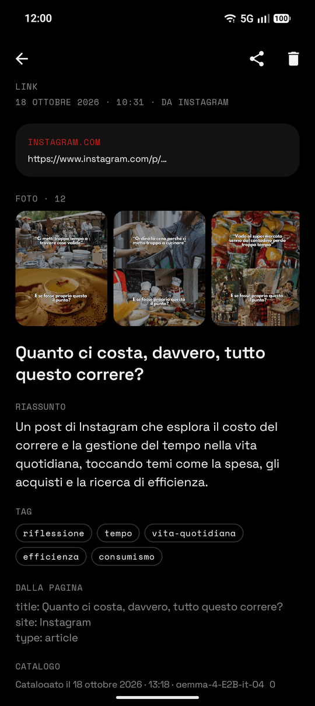
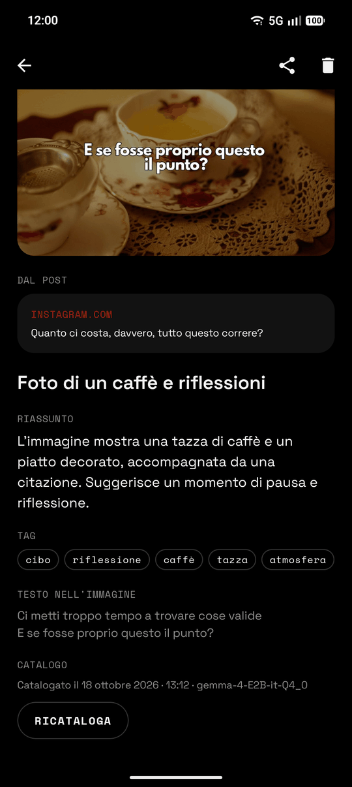
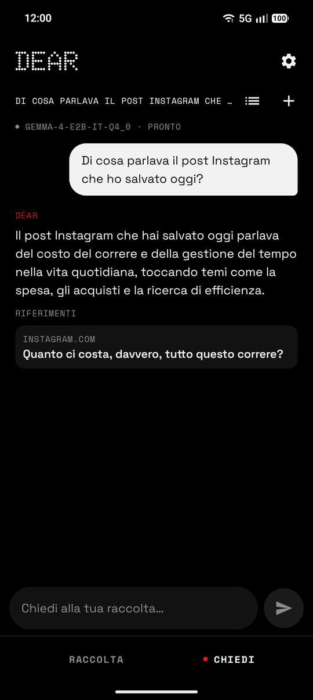

# Dear

A second brain that lives on your Android phone. Share anything into it — links, photos, videos,
voice notes, text — and a local LLM catalogs it for you: a title, a summary, tags, the text inside
images, the transcript of what is said. Then ask your collection questions in plain language.
The model runs on the phone; nothing goes to a cloud.

<p align="center">
  
  
  
  
</p>

## What it does

- **Capture from any app.** Dear is a system share target: share a link, a photo, a video, a voice
  message, and it is saved. Notes can be written with the + button.
- **Catalogs everything, in the background.** Each entry goes through Gemma 4 on the phone:
  - **Photos** — what they show, and any readable text transcribed.
  - **Videos** — a few frames looked at in order, plus the transcript of the audio.
  - **Audio** — transcribed in 30-second chunks, then summarized.
  - **Links** — the page's title and description. For a **public Instagram post** the photos of
    the carousel are pulled in and kept with the link, each one cataloged on its own, and the
    post's summary is written from what they show.

  Cataloging runs in WorkManager, as a foreground service with a silent notification when it
  starts while you are using the phone (e.g. right after sharing), so Android gives it every core
  and doesn't cut it short. It saves progress after every frame or audio chunk, so a run Android
  stops half-way resumes instead of starting over.
- **Collection** — everything by day, with search over titles, summaries, tags and transcribed
  text, and filters by type.
- **Ask** — chat with your collection ("what was that link about slow living?", "what did I save
  this week?"). Answers cite the entries they come from, and the citations open them.
- **Archive** — export the whole collection (entries, files, chats) to a single .zip from Settings,
  and import it back on another install or another phone. Models are not included.

The interface is in Italian.

## Models

Downloaded once from Hugging Face in Settings, or imported from local copies of the same files
(the model and its projector, under their original names).

| Model | Size | RAM | Notes |
|---|---|---|---|
| Gemma 4 E2B (Q4_0) | 2.8 GB + 0.6 GB projector | ≥ 6 GB | Recommended. Text, images and audio. |
| Gemma 4 E4B (Q4_0) | 4.6 GB + 0.6 GB projector | ≥ 8 GB | Better quality, slower. |

Cataloging output is constrained by a JSON grammar, so every reply parses. arm64 devices only.

## Privacy

On-device by default: no account, no telemetry, no cloud. Entries live in app-internal storage and
Android backup is disabled. The app goes online only for:

- **The model download**, once, from huggingface.co.
- **Saved links**: the app fetches the URL itself (no proxy) to read its title and Open Graph
  metadata; YouTube and Vimeo links go through their oEmbed endpoints. The site sees your IP and
  the URL.
- **Instagram posts**: the post's public embed page and its photos from Instagram's CDN.

Everything else — notes, shared media, cataloging, search, chat — works offline.

## Status

Early (0.1). Working: share capture, multimodal cataloging, collection with keyword search, ask
with citations, export/import of the archive. Planned: semantic search with an embedding model,
videos and reels from Instagram.

## Stack

- Kotlin, Jetpack Compose, Material 3, Navigation Compose
- [llama.cpp](https://github.com/ggml-org/llama.cpp) with libmtmd over JNI, for text, image and
  audio input
- Room (exported schemas, explicit migrations), WorkManager, Coil

## Architecture

```
app/src/main/java/dev/deiv/dear/
├── DearApp.kt                 # Application: manual DI, schedules cataloging
├── catalog/
│   ├── CatalogWorker.kt       # WorkManager job that runs the catalog queue
│   ├── CatalogProcessor.kt    # Picks pending entries, retries, progress
│   └── PostPhotos.kt          # Pulls the photos of a shared post into entries
├── llm/
│   ├── LlmEngine.kt           # Engine interface (requests, media, JSON schema)
│   ├── LlamaEngine.kt         # llama.cpp implementation (JNI)
│   ├── ModelManager.kt        # Load on demand, release when idle
│   ├── ModelCatalog.kt        # Downloadable models
│   ├── EntryCataloger.kt      # Title, summary, tags, visible text, transcripts
│   └── DiaryAssistant.kt      # Answers questions about the collection
├── media/                     # Audio decoding, video frame extraction
├── net/                       # Link metadata, Instagram embed reader
├── data/
│   ├── backup/                # Archive: export/import of the collection as a zip
│   ├── db/                    # Room database and DAOs
│   ├── model/                 # Entry, Tag, chat sessions
│   └── repository/            # EntryRepository, ChatRepository, keyword matching
└── ui/
    ├── collection/            # Collection: timeline, search, filters, + note
    ├── entry/                 # Entry detail
    ├── ask/                   # Chat with the collection
    ├── settings/              # Model install, catalog activity
    ├── share/                 # ShareReceiverActivity (system share target)
    └── theme/
```

## Build

Needs the Android SDK with NDK 29 and CMake.

```bash
git submodule update --init --recursive   # first time: pulls llama.cpp
./gradlew assembleDebug                   # build the APK
./gradlew installDebug                    # build and install on a connected device
```

## License

MIT
